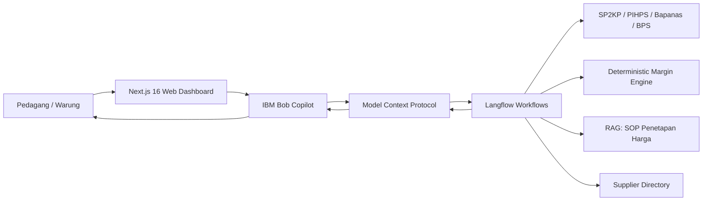

# Warung Cost Guard — Copilot Harga Pangan dan Margin Pedagang Kecil Indonesia

> **Hacktiv8 × IBM SkillsBuild National Hackathon 2026**  
> **Tema:** Produktivitas & Bisnis Cerdas (*Productivity & Smart Business*)  
> **Integrasi Utama:** IBM Bob + Langflow + Model Context Protocol (MCP) + Flexible OpenAI-Compatible LLM

---

## 1. Project Overview

**Warung Cost Guard** adalah AI Copilot keputusan harga pangan dan proteksi margin untuk pemilik warung makan, warteg, pedagang pasar rakyat, dan UMKM kuliner di Indonesia.

Sistem memecahkan masalah mendasar pedagang kecil: ketika harga kulakan melonjak, keputusan **“apakah harga jual dinaikkan, ditahan, porsi diubah, atau negosiasi supplier?”** kerap diambil secara spekulatif tanpa mengetahui biaya efektif nyata (*yield-adjusted cost*) dan tanpa data pembanding pasar resmi lokal.

> **Value Proposition:**  
> *“Sebelum menaikkan harga, tahu dulu biaya sebenarnya (modal + transport + susut), harga pasar lokal resmi, sisa margin riil, dan tindakan paling rasional.”*

---

## 2. Arsitektur Integrasi (Bob, MCP, Langflow)



1. **IBM Bob**: Bertindak sebagai agen percakapan ramah dan profesional yang mengidentifikasi konteks pedagang dan memanggil perkakas MCP yang tepat.
2. **Model Context Protocol (MCP)**: Kontrak standar terbuka dengan 4 perkakas yang tervalidasi skema Zod ketat.
3. **Langflow**: Mesin orkestrasi alur kerja (*workflow engine*) yang menghubungkan model bahasa (OpenAI / Groq / OpenRouter / Ollama), RAG SOP, dan komponen kalkulasi Python/TypeScript.
4. **Flexible AI Model Inference**: Komponen OpenAI-Compatible agnostik yang dapat diarahkan ke penyedia LLM mana pun sesuai preferensi pengguna.

---

## 3. Empat Perkakas Inti MCP

| Nama Tool | Fungsi | Deterministik? | Human-in-the-Loop? |
| :--- | :--- | :---: | :---: |
| `get_market_prices` | Mengambil harga pasar lokal Surabaya (SP2KP, PIHPS, Bapanas) | Ya (Median) | Otomatis |
| `calculate_margin` | Menghitung biaya efektif (yield-adjusted), laba kotor, dan % margin | **Ya (Non-LLM)** | Otomatis |
| `suggest_price_action` | Menganalisis kondisi margin, batas HET, dan 3 opsi tindakan | Ya (SOP Rule Engine) | Otomatis |
| `notify_supplier` | Mengirim pesan negosiasi WhatsApp ke supplier | Ya | **Wajib Konfirmasi** |

---

## 4. Formula Perhitungan Margin Deterministik

Perhitungan finansial dilakukan secara matematis murni tanpa halusinasi model bahasa:

$$\text{Biaya Efektif Riil} = \frac{\text{Harga Beli Supplier} + \text{Ongkos Angkut}}{1 - (\text{Susut Fisik \%} / 100)}$$

$$\text{Laba Kotor} = \text{Harga Jual} - \text{Biaya Efektif Riil}$$

$$\text{Gross Margin \%} = \left(\frac{\text{Laba Kotor}}{\text{Harga Jual}}\right) \times 100\%$$

---

## 5. Kepatuhan Regulasi & Responsible AI (10 Aturan Emas)

1. **Kepatuhan UU No. 5/1999 (Anti-Monopoli & Larangan Kartel):** Sistem hanya mengoptimalkan efisiensi biaya internal satu usaha. Tidak memfasilitasi koordinasi harga atau penetapan harga antar pedagang pesaing.
2. **Kepatuhan Batas HET Resmi:** Memverifikasi Harga Eceran Tertinggi pemerintah (contoh: Minyakita Rp15.700/liter per Permendag 18/2024; Beras SPHP Rp12.500/kg).
3. **Zero Financial Hallucination:** Operasi finansial dan kalkulasi laba dieksekusi oleh modul TypeScript murni.
4. **Wajib Human-in-the-Loop:** Tool `notify_supplier` menolak mengirim pesan bila `confirmed: false`.
5. **Transparansi Atribusi Sumber:** Selalu menampilkan asal data harga (SP2KP, PIHPS, Bapanas, BPS).
6. **Pemisahan Kategori Informasi:** Menyajikan secara tegas perbedaan antara fakta pasar, hasil kalkulasi, dan rekomendasi AI.
7. **Rekomendasi Maksimal 3 Opsi:** Tidak membebani pengguna dengan pilihan spekulatif yang berlebihan.
8. **Konteks Makro BPS:** Menyertakan indikator inflasi pangan BPS WebAPI (Jawa Timur 3,19% y-on-y).
9. **Keamanan Kredensial Server-Side:** Seluruh kunci API disimpan eksklusif pada variabel lingkungan server.
10. **Tanda Data Simulasi Transparan:** Semua mode evaluasi berlabel jelas `MODE DEMO: DATA SIMULASI`.

---

## 6. Skenario Demo untuk Pengujian Juri

Antarmuka dilengkapi bilah pemilih skenario interaktif di bagian atas:
* **Skenario A (Supplier Naik → Margin Tertekan):** Harga ayam ras melonjak dari Rp32.000 ke Rp36.500/kg. Warteg menjual Rp45.000. Margin anjlok ke 11,1% (target 18%). Bob merekomendasikan negosiasi kuantiti supplier atau kontrol porsi sebelum menaikkan harga jual.
* **Skenario B (Harga Pasar Stabil & Batas HET):** Modal Minyakita Rp14.800. Pedagang ingin menjual Rp16.500. Bob memperingatkan batas HET resmi Rp15.700/liter dan mengarahkan ke efisiensi modal beli.
* **Skenario C (Negosiasi Supplier Alternatif):** Cabai rawit merah kulakan Rp60.000 dengan susut 8%. Margin tersisa 4,8% (kritis). Bob menyusun draf WhatsApp negosiasi ke kontak supplier dengan konfirmasi pengguna.

---

## 7. Cara Menjalankan Aplikasi

### Prasyarat
* Node.js v18+ atau v20+ / v22+
* npm v10+

### Instalasi
```bash
# 1. Masuk ke direktori
cd siaga

# 2. Instal dependensi (jika belum)
npm install

# 3. Setup file lingkungan
cp .env.example .env.local
```

### Menjalankan Server Pengembangan
```bash
npm run dev
```
Akses antarmuka di: `http://localhost:3000`

### Menjalankan Unit Test (24 Tests)
```bash
npm test
```

### Pengecekan Tipe TypeScript
```bash
npx tsc --noEmit
```

### Membangun Versi Produksi
```bash
npm run build
npm start
```
