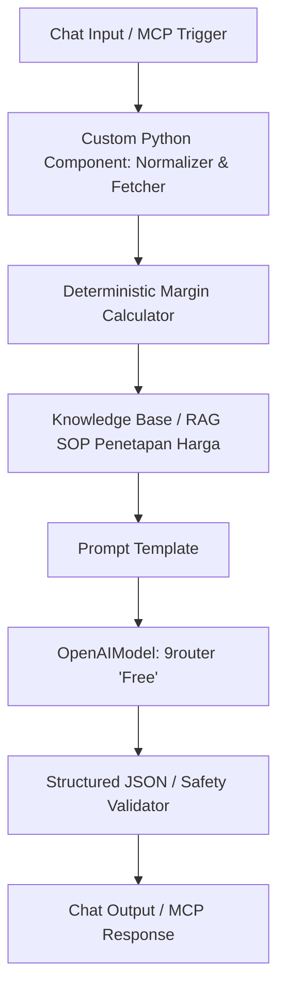

# Panduan Konfigurasi Langflow — Warung Cost Guard

Warung Cost Guard mengadopsi arsitektur resmi hackathon:
**Pengguna / Web UI $\rightarrow$ IBM Bob Copilot $\rightarrow$ Model Context Protocol (MCP) $\rightarrow$ Langflow Workflows**.

---

## 1. Konfigurasi Endpoint Model Provider (9router)
Model language inference di Langflow dikonfigurasikan menggunakan endpoint OpenAI-Compatible gratis:
* **Base URL**: `https://9router.diwanparker.tech/v1`
* **Model Name**: `"Free"`
* **API Key**: `${OPENAI_API_KEY}` (atau kunci API OpenAI-compatible Anda)
* **Temperature**: `0.3` (Konsisten & minim halusinasi)

---

## 2. Struktur Flow Langflow



---

## 3. Template Prompt Sistem di Langflow

```text
Anda adalah Warung Cost Guard, Copilot Harga Pangan & Margin untuk pedagang kecil Indonesia.

ATURAN UTAMA:
1. Gunakan HANYA angka harga, biaya, dan margin yang diberikan oleh tool.
2. JANGAN menciptakan harga pasar sendiri.
3. JANGAN menghitung ulang angka finansial dengan perkiraan (LLM jangan berhitung manual).
4. JANGAN memerintahkan user menetapkan harga tertentu tanpa menjelaskan dasar.
5. Pisahkan secara tegas:
   - 1. Fakta data pasar
   - 2. Hasil perhitungan margin riil
   - 3. Rekomendasi tindakan (Maksimal 3 opsi rasional)

SOP Penetapan Harga:
{sop_context}

Data Pasar Lokal:
{market_data}

Perhitungan Biaya & Margin:
{margin_data}

Konteks Profil Usaha:
{business_role}
```

---

## 4. Ekspor Starter Project Langflow
File starter flow siap impor tersedia pada:
`langflow/WarungCostGuard_Starter.json`
