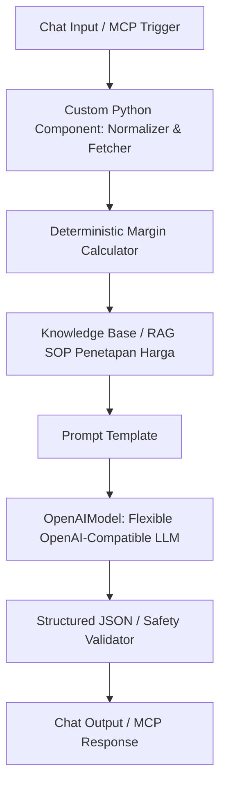

# Panduan Konfigurasi Langflow — Warung Cost Guard

Warung Cost Guard mengadopsi arsitektur resmi hackathon:
**Pengguna / Web UI $\rightarrow$ IBM Bob Copilot $\rightarrow$ Model Context Protocol (MCP) $\rightarrow$ Langflow Workflows**.

---

## 1. Konfigurasi Endpoint Model Provider (Bebas / Agnostik)
Model language inference di Langflow dan aplikasi dirancang **provider-agnostic** menggunakan standar OpenAI-Compatible API. Pengguna atau evaluator **bebas menggunakan model AI dan penyedia layanan apapun**:

| Provider | Base URL | Rekomendasi Model Name | Keterangan |
| :--- | :--- | :--- | :--- |
| **OpenAI (Resmi)** | `https://api.openai.com/v1` | `gpt-4o-mini` atau `gpt-4o` | Standar industri |
| **Groq** | `https://api.groq.com/openai/v1` | `llama-3.3-70b-versatile` | Inferensi ultra-cepat |
| **OpenRouter** | `https://openrouter.ai/api/v1` | `meta-llama/llama-3.1-8b-instruct` | Multi-model aggregator |
| **Ollama (Lokal)** | `http://localhost:11434/v1` | `llama3` atau `mistral` | Offline, privasi penuh |
| **9router (Demo Proxy)** | `https://9router.diwanparker.tech/v1` | `Free` | Alternatif proxy demo gratis |

### Parameter Node OpenAIModel di Langflow:
* **OpenAI API Base**: Masukkan Base URL provider pilihan Anda (atau kosongkan untuk default OpenAI).
* **Model Name**: Masukkan nama model pilihan Anda (contoh: `gpt-4o-mini`, `llama-3.3-70b-versatile`, dll.).
* **API Key**: `${OPENAI_API_KEY}` atau kunci API dari provider pilihan Anda.
* **Temperature**: `0.3` (Disarankan rendah agar konsisten & minim halusinasi).

---

## 2. Struktur Flow Langflow



---

## 3. Template Prompt Sistem di Langflow

```text
Anda adalah Warung Cost Guard, Copilot Harga Pangan & Margin untuk pedagang kecil Indonesia.

ATURAN UTAMA:
1. Gunakan HANYA angka harga, biaya, dan margin yang diberikan oleh tool.
2. JANGAN menciptakan harga pasar sendiri.
3. JANGAN menghitung ulang angka finansial dengan perkiraan (LLM jangan berhitung manual).
4. JANGAN memerintahkan user menetapkan harga tertentu tanpa menjelaskan dasar.
5. Pisahkan secara tegas:
   - 1. Fakta data pasar
   - 2. Hasil perhitungan margin riil
   - 3. Rekomendasi tindakan (Maksimal 3 opsi rasional)

SOP Penetapan Harga:
{sop_context}

Data Pasar Lokal:
{market_data}

Perhitungan Biaya & Margin:
{margin_data}

Konteks Profil Usaha:
{business_role}
```

---

## 4. Ekspor Starter Project Langflow
File starter flow siap impor tersedia pada:
`langflow/WarungCostGuard_Starter.json`
